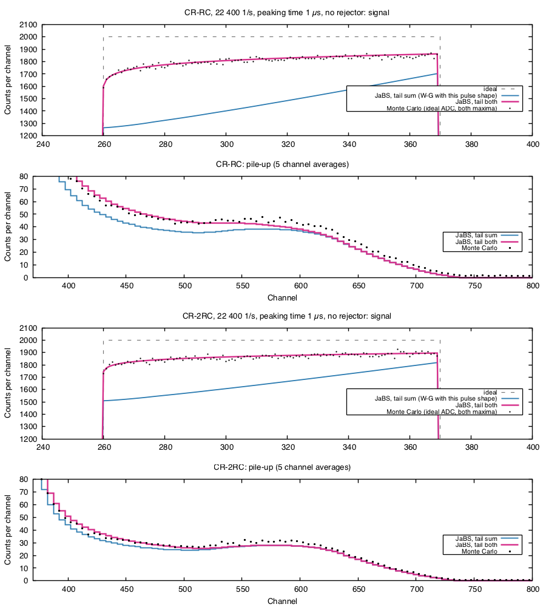
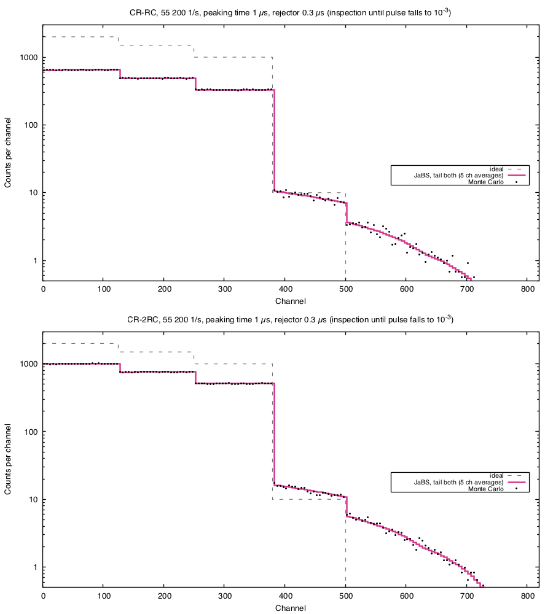
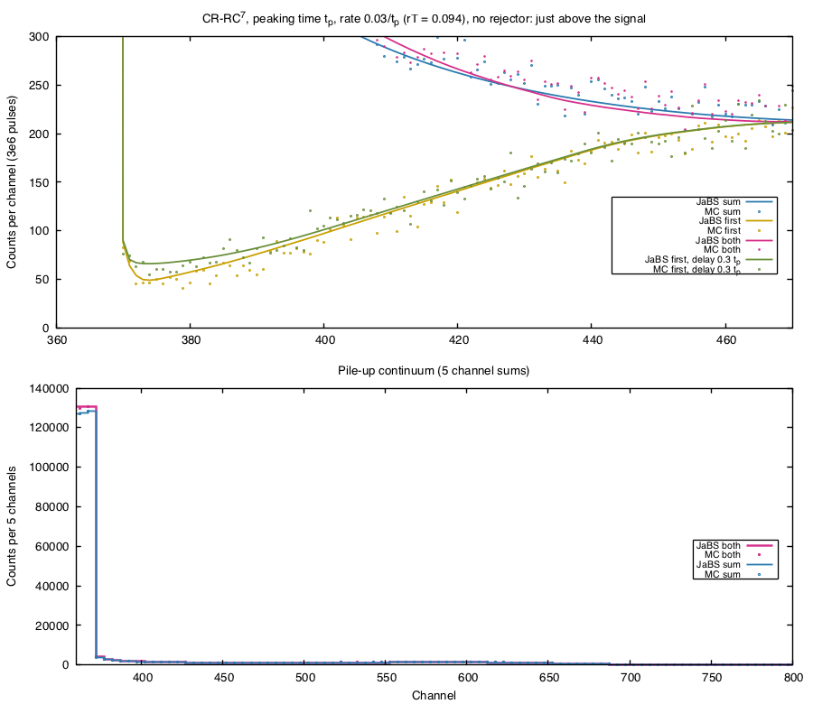

# Pulse pile-up in JaBS

JaBS can add pulse pile-up to a simulated spectrum. Pile-up is calculated for pairs of pulses (first order) after the spectrum, including dual
scattering, has been simulated. It is the last step before the spectrum is compared with the measurement. The implementation is in
[`src/pileup.c`](../src/pileup.c) and [`src/pileup.h`](../src/pileup.h).

## Quick start

```
set det live_time 300s real_time 310s
set det pileup_shaper gaussian pileup_shaping 1us
simulate
```

Pile-up is simulated when `live_time` is set and the shaper times are non-zero. The result spectrum "Pile-up" shows the events from pairs. When
pile-up is simulated, `live_time` of each detector can be fitted (`det1_live_time` etc.), which fits the pile-up level when the count rate is not
known.

## Parameters

All parameters are detector variables (`set det ...`). Times take units (e.g. `1us`, `300s`).

| Variable | Default | Description |
|---|---|---|
| `live_time` | 0 | Time the system is not dead. Dead time includes decay of the signal and conversion. Pile-up is simulated only if this is set. |
| `real_time` | 0 | Real time. If set, count rate is the number of counts in the simulated spectrum divided by real time, and the spectrum is scaled by live time / real time. If not set, the simulated spectrum corresponds to live time (the fluence includes the dead time correction). |
| `pileup_shaper` | `none` | `trapezoid` (digital) or `gaussian` (analog semi-Gaussian, CR-RC^n). |
| `pileup_rise` | 0 | Trapezoid: rise time. |
| `pileup_flat` | 0 | Trapezoid: flat top. Amplitude is sampled at the end of the flat top. |
| `pileup_shaping` | 0 | Gaussian: shaping time. Peaking time is 2.2 times this (Ortec convention), for any order. |
| `pileup_order` | 7 | Gaussian: pulse shape is CR-RC^n with this n (1 to 16). CR-RC^7 has a 0.1 % width of 2.97 peaking times (Ortec: 2.9). For a true CR-RC^n amplifier with time constant RC, set shaping time n RC / 2.2. |
| `pileup_tail` | `first` | What is recorded when two pulses overlap, see below: `sum`, `first` or `both`. |
| `pileup_conversion_delay` | 0 | Gaussian: conversion starts this long after the first maximum of a pulse. Until then the peak detector follows the signal. |
| `pileup_pair_resolution` | 0 | Pulses closer than this are not resolved (by a pile-up rejector or a trigger filter). Zero: not known. |
| `pileup_reject` | `true` | Pile-up rejection. Pairs resolved by pile-up inspection (`pileup_pair_resolution` > 0) are rejected. |

### Tail modes

When a second pulse arrives before the first one has decayed, the sum of the two pulses has one maximum (the pulses merge) or two maxima (tail
pile-up, the second pulse rides on the tail of the first).

| `pileup_tail` | Gaussian shaper | Trapezoid |
|---|---|---|
| `sum` | One event at the highest maximum (Wielopolski and Gardner, NIM 133 (1976) 303). | One event, second pulse is lost. |
| `first` | One event. The peak detector holds the first maximum, but follows a rising second pulse until conversion starts (`pileup_conversion_delay`). Second pulse is lost. | Same as `sum`. |
| `both` | As `first`, and the second maximum, if it comes after the start of the conversion, is recorded as another event at its amplitude (Molodtsov and Gurbich, NIMB 267 (2009) 3484). | A second pulse at least `pileup_pair_resolution` after the first triggers its own event (if not rejected), sampled on the falling edge of the first trapezoid. |

`both` is an ADC that can convert the second pulse, `first` an ADC that is still converting (or waiting for the signal to return to baseline)
when the second maximum comes. `first` is the default. Merged pulses (one maximum) give one event in all modes.

## Model

### Count rate, live time and real time

Pulses arrive randomly (Poisson) at rate r = N / real time, where N is the number of counts in the simulated spectrum. The system is dead from the
arrival of a pulse until its signal has decayed and it has been converted. A pulse arriving in live time is a *leading pulse*. There are
N × live time / real time leading pulses. A pulse arriving within time T after a leading pulse arrives in dead time and forms a pair with it.
Pulses arriving in dead time are lost (dead time losses, corrected by live time) unless they pile up with the leading pulse.

- Fraction exp(−r T) of leading pulses have no pulse following within T, these are recorded as simulated (unpiled pulses are scaled by this).
- A trailing pulse arrives dt after the leading pulse with probability density r exp(−r dt). The pair gives one event (merged, or second pulse
  lost) or two events (`both`).
- In `both` mode, a recorded trailing pulse may be followed by another pulse within T, and so on. Without a rejector second events are weighted by
  1 / (1 − p), p = 1 − exp(−r T) (expected number of links in the chain, each approximated by a pair).
- With a rejector, pairs with pair resolution ≤ dt < T are rejected. Recorded pairs are rejected if a third pulse follows within T, so recorded
  pairs are weighted by exp(−r T).

With tail `sum` or `first` and no rejector the number of recorded events is the number of leading pulses (counts are conserved if real time is not
given).

Amplitudes add in channels, i.e. zero amplitude is channel 0. The calibration offset should be small. The simulated spectrum has twice the channels
when pile-up is simulated.

### Trapezoidal shaper

T = rise + flat. The amplitude of the leading pulse is sampled at the end of its flat top: A1 + g A2, where g = 1 if the trailing pulse arrives
during the flat top and g decreases linearly to zero during the rise of the trailing pulse. A resolved trailing pulse (`both`, no rejection) is
sampled at the end of its own flat top: A2 + max(1 − dt / rise, 0) A1. The distribution of the added amplitude is calculated per channel and
convolved with the spectrum (sum of uniform amplitudes in two bins is a triangle).

### Gaussian shaper

Pulses are unipolar CR-RC^n, y(t) = (t / t_p)^n exp(n (1 − t / t_p)), t_p is the peaking time. T is the time from the start of a pulse until it falls
to 10^−3 of its maximum (3.13 t_p for n = 7, 6.29 t_p for n = 2, 10.2 t_p for n = 1).

For the sum (1 − q) y(t) + q y(t − u), where q = A2 / (A1 + A2) and u is the time between pulses in units of peaking time, the times and values of
the first and second maximum are tabulated (q in 64 steps, u in steps of 0.0125 t_p up to T) when the order is first used. The amplitudes of the
events for the given tail mode and conversion delay are derived from this table for each simulation. For every pair of channels the amplitude is
interpolated in q and is linear in u between nodes (nodes four times further apart for u > 2). Probability between nodes is distributed uniformly
between the amplitudes of the nodes. Intervals are merged until the amplitude changes by 0.25 channels, and the width of the channel is
approximated by two copies shifted by ±0.25 channels. The uniform distributions are accumulated as ramps of a cumulative distribution, which is
differentiated once. With two maxima the maxima are about 0.6 t_p or more apart (n = 7), the first maximum is A1 if u > 1.

The calculation is O(n²) in the number of non-zero channels: about 0.1 s (rejector) to 0.5 s (no rejector) for 850 channels.

## Validation

### Monte Carlo

A Monte Carlo of pulse trains was compared to the model: random arrival times, amplitudes drawn from the spectrum, the signal (sum of pulses)
calculated in steps of 0.01 t_p and its maxima found. Pulses closer than T to each other form a cluster, the system is dead from the first pulse of a
cluster until the last one has decayed (this defines live time). `sum`: one event at the highest maximum of the cluster. `first`: the first maximum,
held until conversion starts. `both`: every maximum after the previous conversion has started. Rejector: clusters where pulses are resolved are
rejected. Trapezoid: triggers (closer than pair resolution: no trigger), sampled at trigger time + rise + flat.

| Case | rT | Total, model / MC | Signal | Pile-up continuum |
|---|---|---|---|---|
| CR-RC, no rejector, `both` | 0.23 | −0.02 % | +0.4 % | +2 to −18 % |
| CR-2RC, no rejector, `both` | 0.14 | −0.01 % | +0.2 % | −3 to −11 % |
| CR-RC^7, no rejector, `sum` / `first` / `both` | 0.094 | < 0.02 % | < 0.2 % | −2 to −7 % (`first`: 0 to +4 %) |
| CR-RC^7, no rejector, `both` | 0.016 | 0.00 % | 0.00 % | −1 to −3 % |
| CR-RC^7, `first` and `both`, conversion delay 0.3 t_p | 0.094 | < 0.02 % | < 0.4 % | up to −7 % |
| CR-RC, CR-2RC, rejector 0.3 t_p | 0.35 to 0.56 | −0.01 to −0.14 % | < 0.3 % | within statistics |
| CR-RC^7, rejector 0.3 t_p | 0.094 | 0.00 % | < 0.2 % | within statistics |
| Trapezoid, trigger 0.2, `both`, no rejection | 0.1 | +0.2 % | +0.4 % | −3 to +4 % |
| Trapezoid, trigger 0.2, rejector | 0.1 | −0.03 % | 0.0 % | within statistics |

The continuum is underestimated by an amount that is roughly proportional to rT (second order: chains of three pulses). Triple pile-up (above
twice the highest amplitude) is not included.

### Molodtsov and Gurbich (2009)

Figures 2 and 3 of the paper, with peaking time 1 µs (in JaBS: shaping 1 µs / 2.2). Thin target, 22 400 1/s, no rejector: with tail pile-up the
plateau of the signal is not flat (small pulses riding on the long tails of CR-RC pulses are shifted up), as in the paper. JaBS `both` follows the
Monte Carlo. Tail `sum` corresponds to an ADC that loses the second pulse, so the signal is lower.



Thick target, 55 200 1/s, rejector 0.3 µs. In JaBS the rejector inspects until the pulse has fallen to 10^−3 (10 t_p for CR-RC), the paper used
pulse width to 1/5 of maximum (about 4 t_p), so the absolute level is not comparable with the paper.



Tail modes for CR-RC^7 (default). Just above the signal `sum` and `both` give similar spectra (the second maximum is recorded either way), `first`
gives much less.



## Limitations

- First order (pairs). Second order effects (chains of three pulses) are approximated for counts but not for amplitudes, the continuum is
  underestimated by roughly 0.5 rT relative to itself. Triple pile-up is not included.
- Pulse shapes are ideal CR-RC^n or trapezoids, without baseline restoration, ballistic deficit or undershoot.
- The rejector inspects for the whole time T.
- Amplitudes are assumed to be proportional to channel (zero amplitude in channel 0).
- Count rate comes from the simulated spectrum only. Pulses outside the simulated spectrum (e.g. noise, other particles) are not included.
